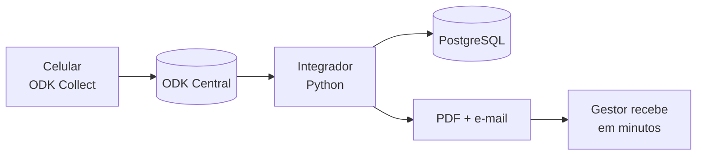
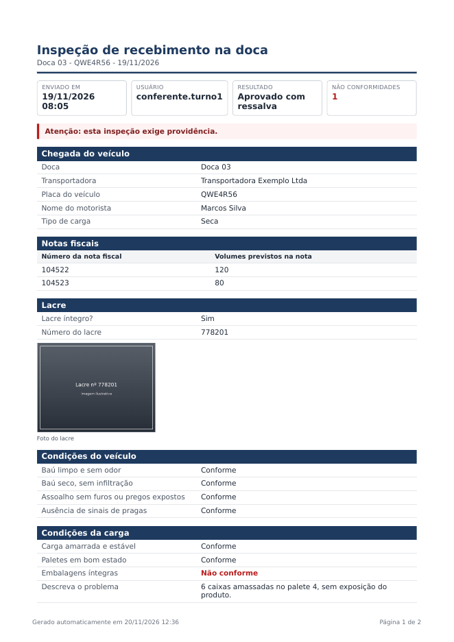

# Checklist operacional com ODK

**Checklists digitais no celular, com fotos e assinatura, que viram relatório em PDF e chegam por e-mail sem ninguém digitar nada.**

Três cenários prontos para uso: **vistoria de veículos**, **inspeção de recebimento na doca** e **inspeção de manutenção industrial**.


> 🇺🇸 **English summary** at the [end of this page](#english-summary).

---

## O problema

Muitas operações ainda inspecionam em papel ou em planilha:

- a folha molha, rasga ou some, e a foto da avaria fica no celular de alguém;
- alguém redigita tudo no fim do dia, com erro e atraso;
- o gestor só descobre o problema quando ele já virou prejuízo: o carro devolvido com avaria que ninguém cobrou, a carga recusada sem evidência, a máquina que quebrou depois de uma inspeção "ok".

## A solução



1. A equipe preenche o checklist no celular, **mesmo sem internet**. Item não conforme exige foto e descrição: não dá para pular.
2. O **ODK Central** recebe as respostas quando o celular volta a ter sinal.
3. O **integrador** busca as respostas novas a cada poucos minutos, grava no banco, gera um **PDF com fotos e assinatura** e envia por e-mail.
4. Se houver não conformidade, o e-mail sai com **[ATENÇÃO]** no assunto e vai também para quem precisa agir.
5. Tudo fica no PostgreSQL, pronto para painéis e indicadores.



Veja os PDFs de exemplo na pasta [`exemplos/`](exemplos/).

## Os três cenários

| Cenário | Para quem | Destaques do formulário |
|---|---|---|
| **Vistoria de veículo** | Locadoras e empresas com frota própria | Placa validada (padrão antigo e Mercosul), 5 fotos obrigatórias, 10 itens, GPS e assinatura do condutor |
| **Recebimento na doca** | Armazéns, centros de distribuição, operadores logísticos | Várias notas fiscais por veículo, conferência de volumes com cálculo automático da divergência, lacre com foto, temperatura para carga refrigerada |
| **Manutenção industrial** | Indústrias e equipes de manutenção | Leitura da TAG por QR Code, bloqueio obrigatório (LOTO) antes de começar, EPIs, alerta de temperatura, fotos antes e depois |

Os formulários são definidos em código ([`formularios/gerar_formularios.py`](formularios/gerar_formularios.py)) e geram os `.xlsx` no padrão [XLSForm](https://xlsform.org), validados com o ODK Validate.

## Rodar em 3 minutos (modo demonstração)

Não precisa de servidor ODK: o modo `demo` usa respostas de exemplo.

**Requisito:** [Docker Desktop](https://www.docker.com/products/docker-desktop/).

```bash
git clone https://github.com/iR0ndD2/checklist-operacional-odk.git
cd checklist-operacional-odk
cp .env.example .env          # no Windows (PowerShell): copy .env.example .env
docker compose up --build
```

Abra **http://localhost:8025**: os três e-mails estarão lá, com os PDFs anexados. Os PDFs também ficam na pasta `saida/`.

Para usar com um servidor real, siga [docs/instalacao-odk-central.md](docs/instalacao-odk-central.md) e troque `MODO=odk` no `.env`.

## Destaques técnicos

- **Carga incremental** pela API OData do ODK Central: só busca o que chegou depois da última leitura.
- **Idempotência:** a mesma resposta lida duas vezes não gera dois e-mails.
- **Tolerância a falhas:** novas tentativas com espera crescente na API, novo login quando o token expira, fila de reenvio quando o e-mail falha.
- **PDF genérico:** os rótulos saem do próprio XLSForm. Um formulário novo funciona só com uma linha de configuração em [`formularios.toml`](integrador/formularios.toml).
- **Segurança:** segredos só no `.env` (fora do Git), usuário do integrador só com leitura no ODK, contêiner sem privilégios de administrador.
- **Testes automatizados** rodando no GitHub Actions a cada envio.

Detalhes e decisões em [docs/arquitetura.md](docs/arquitetura.md).

## Estrutura

```
├── formularios/            # XLSForms (.xlsx) e o gerador em Python
├── integrador/
│   ├── app/                # cliente da API, regras, PDF, e-mail, agendamento
│   ├── sql/schema.sql      # tabelas e visão para painéis
│   ├── tests/              # testes automatizados
│   └── formularios.toml    # formulários acompanhados e destinatários
├── exemplos/               # respostas, fotos e PDFs de exemplo
├── docs/                   # arquitetura e instalação do ODK Central
└── docker-compose.yml
```

## Desenvolvimento

```bash
python -m venv .venv
.venv\Scripts\activate                        # Linux/Mac: source .venv/bin/activate
pip install -r requirements-dev.txt
python formularios/gerar_formularios.py --validar   # o ODK Validate exige Java
cd integrador && pytest
```

## Serviço

Implanto essa solução sob medida: formulários do seu processo, servidor ODK Central, relatórios e alertas por e-mail, integração com o seu sistema (ERP, WMS, TMS) e painéis de indicadores.

**Rondinele Ramos Clemente** · [LinkedIn](https://www.linkedin.com/in/rondinele-ramos-clemente-172a13159/)

> Projeto de portfólio. Os dados, nomes, placas e documentos dos exemplos são fictícios.

---

## English summary

**Operational checklists on mobile (ODK Collect), with photos and signatures, automatically turned into PDF reports and delivered by email.**

Three ready-to-use scenarios: **vehicle inspection** (rental companies and corporate fleets), **dock receiving inspection** (warehouses and logistics operators) and **industrial maintenance inspection**.

- Forms in XLSForm, generated from Python and validated with ODK Validate. Non-conforming items require a photo and a description.
- A Python service pulls new submissions incrementally from the ODK Central OData API, stores them in PostgreSQL, renders a PDF with photos and signature (WeasyPrint) and emails it. Non-conformities trigger an alert email to an extra list.
- Idempotent processing, retries with backoff, re-authentication, a retry queue for failed emails, and automated tests on GitHub Actions.
- **Try it in 3 minutes** without an ODK server: `cp .env.example .env && docker compose up --build`, then open http://localhost:8025 to see the emails.

Portfolio project. All data in the examples is fictitious. Contact: [LinkedIn](https://www.linkedin.com/in/rondinele-ramos-clemente-172a13159/).
