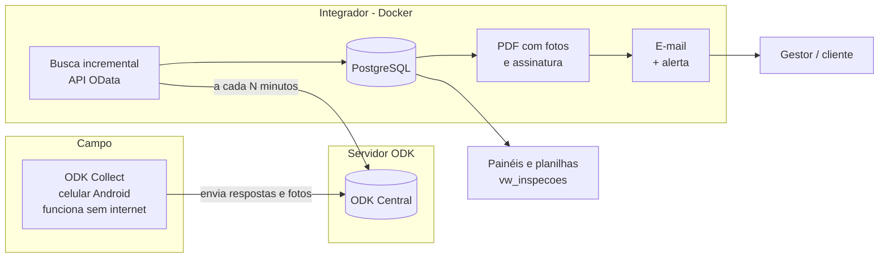

# Arquitetura

## Fluxo de um ciclo

1. **Carga incremental.** Para cada formulário, o integrador lê no banco a data da última resposta já recebida e pede ao ODK Central só o que chegou depois (`$filter` em `__system/submissionDate`), com os grupos repetidos já incluídos (`$expand=*`).
2. **Gravação idempotente.** Cada resposta é gravada com o `instance_id` como chave. Se a mesma resposta vier de novo, ela é ignorada: ninguém recebe e-mail em dobro. A data de controle avança na mesma transação.
3. **Regras.** O integrador conta as não conformidades e lê o campo `resultado`. Se houver não conformidade, ou se o resultado estiver na lista `resultados_alerta`, a inspeção é marcada como alerta.
4. **Relatório.** As fotos e a assinatura são baixadas da API, e o PDF é montado a partir dos rótulos do próprio XLSForm.
5. **Envio.** O PDF vai para os destinatários do formulário. Em alerta, o assunto ganha `[ATENÇÃO]` e a lista de alerta entra em cópia.
6. **Falhas.** Se o PDF ou o e-mail falhar, a resposta fica com status `erro` e o motivo registrado. O próximo ciclo tenta de novo, até 5 vezes. Um formulário com problema não trava os outros.

## Decisões

| Decisão | Motivo |
|---|---|
| Ler pela API, nunca direto no banco do Central | O banco interno muda entre versões. A API é o contrato estável. |
| Rótulos lidos do `.xlsx` | Mudou a pergunta no formulário, o PDF acompanha sem mexer em código. |
| Carga e envio separados | Se o e-mail cair, nada se perde: a resposta já está no banco, esperando. |
| Resposta completa em `JSONB` | Permite criar indicadores depois sem buscar tudo de novo. |
| Modo `demo` | Qualquer pessoa roda o projeto inteiro sem servidor ODK. |
| Usuário do integrador só com leitura | Menor privilégio: se a senha vazar, ninguém altera dados. |

## Estrutura do banco

| Tabela | Conteúdo |
|---|---|
| `submissao` | Uma linha por resposta: dados completos, resultado, alerta, status do envio |
| `controle_carga` | Até onde cada formulário já foi lido |
| `envio_email` | Histórico de envios (auditoria) |
| `vw_inspecoes` | Visão pronta para painéis (Power BI, Metabase, planilhas) |
